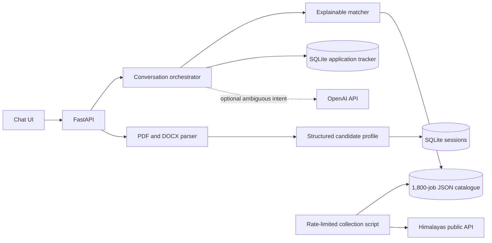

# Orbit — conversational job search assistant

Orbit is a single-service AI job chat assistant built for the Hidani Tech SDE Intern assessment. A candidate uploads a PDF or DOCX resume, reviews extracted details, asks for matching jobs, refines the search in conversation, and tracks application progress. The committed JSON catalogue contains **1,800 real job listings** collected from the public Himalayas Jobs API on 21 October 2026.

> **Honest application status:** Public job boards do not provide a universal unauthenticated employer submission API. “Start application” stores the job once and opens its original application link. The record stays **awaiting external submission** until the candidate confirms they submitted on the employer site. Orbit never claims a third-party submission it cannot verify.

## Run locally

Requires Python 3.11+.

```bash
python -m venv .venv
# Windows: .venv\Scripts\activate
# macOS/Linux: source .venv/bin/activate
pip install -r requirements.txt
uvicorn app.main:app --reload
```

Open `http://127.0.0.1:8000`. The app works without an LLM key using a deterministic intent router. To enable LLM-assisted intent interpretation, set `OPENAI_API_KEY` in your shell or host; `.env.example` documents the available variables but the app does not load a `.env` file automatically. For ambiguous messages, OpenAI function calling selects the `route_job_request` tool with a strict schema. The model only chooses intent and filters; job facts, ranking, and application state remain grounded in local data.

Run the core flow tests:

```bash
python -m pytest -q --basetemp=.pytest_run
```

`pytest` is a development dependency; install it with `pip install pytest` if needed.

## Architecture and dataflow



The orchestrator in `app/agent.py` routes natural-language requests to specialized parsing, matching, application, and status tools. Clear commands use a deterministic router; an optional LLM function call interprets ambiguous messages. It cannot write an application or invent a listing. The resume parser extracts only text from the uploaded file and stores a structured profile rather than the original resume. Matching combines designation tokens, skill overlap, experience constraints, and conversational filters, then returns a reason for each result. SQLite enforces one application per anonymous session and job ID.

Anonymous sessions use a browser-generated UUID in `localStorage`. There is no account recovery or cross-device sync. The UUID is a bearer token, so anyone with it can view that session's profile and tracker. Avoid using real sensitive resumes on a shared public demo; use a sample resume for the recording. The original uploaded file is not retained.

## API

| Route | Purpose |
|---|---|
| `GET /health` | Readiness and catalogue count |
| `GET /api/bootstrap?session_id=<uuid>` | Load session profile, filters, and applications |
| `POST /api/resume` | Multipart `session_id` and `file`; returns parsed profile and initial matches |
| `POST /api/chat` | JSON `session_id`, `message`, optional `job_id`; returns reply and tool results |

Resume uploads are limited to 8 MB and PDFs to 20 pages. Unreadable or scanned resumes return a clear 422 response. Invalid job references receive a conversational recovery message. A matching query with no results suggests changing filters.

## Job data

`scripts/scrape_jobs.py` paginates the [Himalayas public Jobs API](https://himalayas.app/api) using opaque cursors, retries transient errors and rate limits, deduplicates by source job ID, normalizes description HTML to text, and writes `data/jobs.json` atomically. Every result retains source attribution and the API-provided application URL, as required by the [Himalayas API terms](https://himalayas.app/terms). Run a refresh with:

```bash
python scripts/scrape_jobs.py --target 1800
```

The scraper refuses to write fewer than 1,500 valid listings. It does not fabricate missing experience or skill information: unknown experience is labeled `Not specified`, and skills are extracted from listing text using a transparent vocabulary. Expired jobs are excluded by the collector and the matcher. Jobs are a snapshot, so source availability may change after collection. Refresh and verify the dataset immediately before submitting.

## Deployment

The included Dockerfile serves both frontend and API. For Railway, create a project from the public GitHub repository, let it detect the Dockerfile, generate a public domain, and add a **persistent volume mounted at `/data`**. Set `DATABASE_PATH=/data/app.db` and optionally `OPENAI_API_KEY` and `OPENAI_MODEL`. Keep the service at one replica when using SQLite. Configure `/health` as its health check. A persistent volume is necessary because applications and session profiles must survive redeploys. Verify the public `/health` endpoint reports `1800` jobs, then test upload, search, start application, confirm submission, and status on the live domain.

The Docker image includes the JSON snapshot. Refreshing jobs requires rerunning the scraper, committing the updated file, and redeploying. No personal resume file or application database belongs in the public repository.

## Assessment submission checklist

- [x] Public-source scraper and 1,800-listing JSON database
- [x] Resume upload, extraction, matching, conversational filters, application tracking
- [x] Duplicate protection and error paths
- [x] README with setup, architecture, dataflow, and APIs
- [ ] Public GitHub repository
- [ ] Persistent deployment and verified live link
- [ ] 3–5 minute screen recording showing upload → parsed profile → recommendations → refinement → start application → external site → confirmed status
- [ ] Final check of source links, mobile layout, and deployment logs

See `PHASES.md` for the five-phase delivery plan and `DEMO.md` for a four-minute recording outline.
