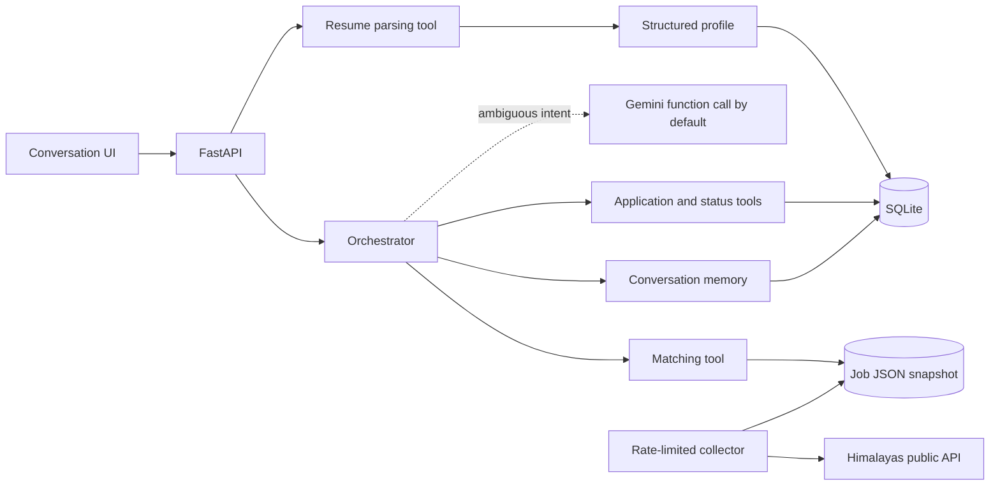

# Orbit — a conversational job search workspace

[](https://github.com/ABHISHEK27Y/hidani-assessment/actions/workflows/ci.yml)

[Live app](https://orbit-assessment-r2j9.onrender.com) · [Public repository](https://github.com/ABHISHEK27Y/hidani-assessment) · [Download all source files](https://github.com/ABHISHEK27Y/hidani-assessment/archive/refs/heads/main.zip) · [Run and deployment guide](DEPLOYMENT.md)

[](https://render.com/deploy?repo=https://github.com/ABHISHEK27Y/hidani-assessment)

Orbit reads a resume, explains relevant jobs, refines results through conversation, and keeps application progress in one workspace. It is built for the Hidani Tech SDE Intern assessment with Python/FastAPI, browser JavaScript, a 1,800-job JSON snapshot, and SQLite. The interface uses black glass panels and muted purple accents, with desktop, tablet and phone layouts.


## Local setup

Requires Python 3.11 or newer. The top-level dependency versions are pinned to the versions used during verification.

```bash
python -m venv .venv
# Windows PowerShell
.venv\Scripts\Activate.ps1
# macOS/Linux: source .venv/bin/activate
pip install -r requirements-dev.txt -c constraints.txt
python -m uvicorn app.main:app --reload --no-access-log
```

Open `http://127.0.0.1:8000`. Copy `.env.example` to `.env` to configure the app; `.env` is loaded automatically and excluded from Git. `requirements.txt` contains runtime dependencies, while `requirements-dev.txt` adds tests and the HTTP verifier.

Windows shortcut: `powershell -ExecutionPolicy Bypass -File .\scripts\run.ps1`. For Docker Compose, Railway configuration, API-key setup and troubleshooting, follow **[DEPLOYMENT.md](DEPLOYMENT.md)**. `constraints.txt` pins the dependency versions from the isolated environment.

| Variable | Default | Purpose |
|---|---|---|
| `LLM_PROVIDER` | `gemini` | Select `gemini`, explicit `openai`, or `none` for local commands only |
| `GEMINI_API_KEY` | unset | Google AI Studio key for Gemini intent interpretation |
| `GEMINI_MODEL` | `gemini-3.5-flash-lite` | Default low-latency Gemini routing model; has a Google-documented free API tier |
| `DATABASE_PATH` | `data/app.db` | Local SQLite database path |
| `DATABASE_URL` | unset | PostgreSQL URL; selects persistent Postgres storage on free hosts |
| `JOBS_PATH` | `data/jobs.json` | Job snapshot location |
| `OPENAI_API_KEY` | unset | Used only when `LLM_PROVIDER=openai` is explicitly selected |
| `OPENAI_MODEL` | `gpt-4o-mini` | Model for the explicit OpenAI provider |
| `APPLICATION_MODE` | `assisted` | Assisted external handoff, or explicit `simulation` for assessment demos |

The local router supports resume-driven matching, remote/on-site filters, multiple skills, countries, entry-level and internship filters, pagination, profile corrections, job details, application initiation and status queries. **Gemini 3.5 Flash-Lite is the default LLM** for ambiguous phrasing, with server-validated function arguments. Gemini 3.8 Flash previously passed a live synthetic function call and the full HTTP/orchestrator/matching flow; the lower-latency model was selected for the hosted router. The app continues with local rules on provider failure or quota exhaustion; it never automatically switches providers. OpenAI remains an explicit optional setting. No key is included in the repository.

Google currently lists free input/output usage for Gemini 3.5 Flash-Lite on its [Free tier](https://ai.google.dev/gemini-api/docs/pricing). Use a Free-tier project in [Google AI Studio](https://aistudio.google.com/apikey); quotas and eligibility are account-specific. This app cannot change your project's billing tier. Free-tier conversations may be used to improve Google's products. Resume files are parsed locally, and profile payloads are excluded from model requests; recent conversation text is sent for ambiguous requests, so use fictional data for public demos. See [Google's compatibility documentation](https://ai.google.dev/gemini-api/docs/openai) for the SDK endpoint used.

## Application behavior

In **assisted mode**, “apply to job 3” saves a single application record and returns the API-provided original application link. The status is `awaiting_submission`. After the candidate completes the external form, “I submitted job 3” or the corresponding button records their confirmation and submission timestamp.

In **simulation mode**, the same command completes an explicitly labeled local demo submission with a `SIM-…` receipt. The UI identifies this mode and every simulated record. It sends no application to an employer. Set `APPLICATION_MODE=simulation` and restart to demonstrate this workflow.

**Actual automatic submission to third-party employers is not implemented.** It requires an authorized integration for each employer/ATS. This distinction is also recorded in the assessment checklist; a local receipt or candidate confirmation is not evidence of employer receipt. The source job site may present its own verification or login page.

## Architecture and dataflow



- **Parsing:** PyMuPDF extracts PDF text and python-docx preserves paragraph/table order. Section-aware parsing detects role titles, skills, contact, education and projects. Dated work ranges are unioned to prevent double counting; education and project dates are excluded from work duration. Raw files and raw resume text are not stored.
- **Matching:** Explicit skill filters, role alignment, work duration, seniority, country restrictions and known country timezone offsets constrain results. The ranking explains shared skills and missing experience information. Unknown numeric experience is not invented. A relevance score is not an offer probability.
- **Orchestration:** `app/agent.py` validates model arguments before invoking tools. Clear commands use local rules. The model cannot invent listings or directly modify the database. The existing OpenAI SDK connects to Google's documented Gemini compatibility endpoint by default. Resume text and profile payloads are not included in the model request; recent conversation text is used for context.
- **Memory:** Rich message payloads restore profile cards, job results and application records after reload. The server keeps up to 200 messages per workspace and returns the latest 40.
- **Persistence:** Local SQLite or hosted PostgreSQL transactions and a unique `(session_id, job_id)` key prevent duplicates, including simultaneous requests. Set `DATABASE_URL` to select PostgreSQL. Started and submitted timestamps are distinct. The browser holds an anonymous UUID; there is no account creation.

Anonymous UUIDs act as bearer secrets. Anyone who knows a workspace ID can access that workspace. This is a no-auth assessment app with local SQLite storage, not an encrypted vault or cross-device account system. Do not publish the application database, `.env`, private resume, or private test files. The repository ignores PDF/DOCX files and temporary verification data.

## API

Interactive schemas are available at `/docs` and `/openapi.json`.

The `/docs` page loads Swagger assets from jsDelivr and uses a nonced initializer. The main workspace uses only local assets. `/openapi.json` remains available without the documentation CDN.

| Endpoint | Input / result |
|---|---|
| `GET /health` | Database readiness, total/active jobs, provider configuration and application mode |
| `GET /api/bootstrap?session_id=<uuid>` | Profile, filters, application count and rich history |
| `POST /api/resume` | Multipart `session_id` and PDF/DOCX `file`; profile plus initial matches |
| `POST /api/chat` | JSON `session_id`, `message`, optional stable `job_id`; conversational tool result |
| `GET /api/jobs/{job_id}` | Full description, restrictions, skills, source and expiry state |
| `GET /api/applications?session_id=<uuid>` | Workspace application records |
| `POST /api/applications` | JSON `session_id`, `job_id`, `action` (`start` or `confirm`) |
| `DELETE /api/session/{session_id}` | Clear that workspace's profile, messages and applications |

Validation errors use 422, unknown job details use 404, oversized request bodies use 413, and rate limits use 429 with `Retry-After`. File uploads are limited to 8 MB, PDFs to 20 pages, and DOCX expansion to 32 MB. The request body is bounded before multipart parsing. Chat messages are trimmed, length-limited and validated. Responses include request IDs, security headers, and private API cache controls. Logs omit access URLs to avoid logging workspace IDs.

## Job collection

```bash
python scripts/scrape_jobs.py --target 1800
python scripts/audit_dataset.py
# Optional small external link sample:
python scripts/audit_dataset.py --check-links 10
```

The collector uses the [Himalayas public API](https://himalayas.app/api). It seeds entry-level software opportunities, then collects software-related and general listings until it has 1,800 unique valid records with extractable skills. It retains source IDs, attribution, the original application link, full country/timezone restrictions, seniority, timestamps and descriptions. Missing numeric experience stays `Not specified`. The final JSON is written atomically; an undersized collection fails before replacing the previous snapshot.

The app preserves [Himalayas attribution and application-link requirements](https://himalayas.app/terms). It excludes expired listings from recommendations. Refresh the snapshot before submission; API expiry metadata cannot establish whether an employer still accepts applications. During this review, ten sampled source-page HTTP checks returned 403 and the normal browser showed a security-verification page. Their external page availability is therefore unverified.

## Verification

```bash
python -m pytest -q --basetemp=.pytest_run
python scripts/verify_local.py --base-url http://127.0.0.1:8000 --resume /absolute/path/to/cv.pdf
node --check static/app.js
```

The private-resume verifier accepts only localhost URLs, omits contact values from its report, and deletes its test workspace afterwards. Tests cover PDF/DOCX parsing, date ranges, skills, matching, geography and timezone filters, pagination, API validation, malicious/invalid tool arguments, provider failure, duplicate writes, session isolation, application modes, expiry and state restoration. Browser checks cover upload, filtering, detail dialogs, application initiation, reset, fixed scrolling and responsive layouts.

See [the complete assessment checklist](ASSESSMENT_CHECKLIST.md), [the final project report](REVIEW.md), and [the five-minute video script](DEMO.md).

Final review: 45 automated tests and 15 actual-resume HTTP checkpoints passed. The fresh isolated installation completed and `pip check` passed. Gemini also passed a live synthetic function call and the full HTTP/orchestrator flow; see [provider evidence](docs/llm-verification.json). GitHub Actions builds and smoke-tests the Docker image; the exact tested commit and run are in [CI evidence](docs/ci-verification.json).

## Release phase

The [live Render app](https://orbit-assessment-r2j9.onrender.com) uses a free Docker web service and free PostgreSQL database. Its public `/health` endpoint and all 13 synthetic HTTP smoke checkpoints passed on 21 October. A fictional resume and application survived a web-service redeployment. Hosted Gemini routing remains under review because the deployment initially received an incorrect provider key. The actual 3–5 minute recording remains pending. See [release evidence](docs/final-release-check.json).
