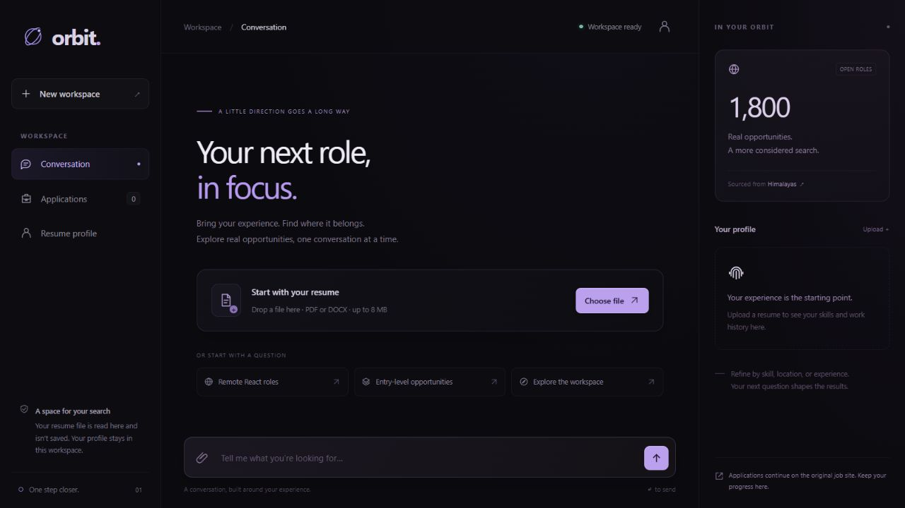
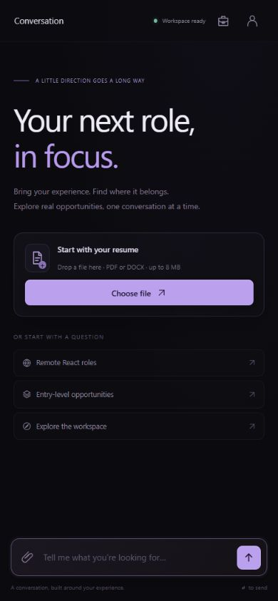

# Final assessment report — 21 October 2026

The project supports resume upload, extraction, experience-aware recommendations, conversational refinement, job details, application tracking and restored history through a black/purple glass interface. The final local API, actual-resume and browser checks passed. Deployment was attempted on Railway, but its platform outage blocked project creation.

The acceptance status for every point in the brief is in **[ASSESSMENT_CHECKLIST.md](ASSESSMENT_CHECKLIST.md)**. The local flow and live Gemini tool routing are verified. Actual employer auto-submission, a public live deployment and the final recording remain incomplete.

## Final checkpoint summary

| Checkpoint | Result |
|---|---|
| 1,500–2,000 real listings, JSON database and scraper | Done: 1,800 unique rows; all required fields and skills present |
| PDF and DOCX parsing; all seven profile sections | Done: automated coverage and actual-resume verification |
| Role, skills and experience matching with reasons | Done |
| Natural chat refinement and conversation memory | Done |
| Orchestrator with parsing, matching and application tools | Done |
| Gemini function calling and provider-error fallback | Done; earlier live evidence retained |
| Application record, date, status and duplicate prevention | Done for the assisted workflow |
| Automatic submission to an external employer | Incomplete; requires an authorized employer integration |
| Bad file, no matches and invalid job number handling | Done |
| No login requirement | Done |
| Public source, README, dataset and scraper | Done: ABHISHEK27Y/hidani-assessment |
| Railway deployment and public end-to-end check | Blocked by Railway's platform outage |
| Five-minute video script | Done: DEMO.md |
| Actual screen recording and final submission | Pending |

This is not a claim that every assessment requirement is complete. In particular, the brief's “assistant applies” requirement remains only partially implemented, and the live-link requirement is blocked. Local test success cannot establish a working public deployment.

## Resume test

The newer resume in the user's job-apply folder was read locally and uploaded to the localhost API and UI. No copy of the PDF, raw text, phone number or email is included in this repository.

| Extraction | Result |
|---|---|
| Name and contact | Detected and displayed in the local profile |
| Designation | Software Engineering Intern |
| Work duration | 3 inclusive calendar months from the dated internship |
| Skills | 30 recognized skills |
| Education | Institute, degree and academic details retained |
| Projects | All 3 project titles and descriptions retained |

The final match counts and response timing are recorded in the redacted `docs/verification.json`. The parser estimates calendar duration, not verified professional tenure. Profile corrections can be supplied in chat.

## Problems found and corrected

1. **Internship title was missed.** The first parser only searched a small header window and did not recognize “Software Engineering Intern”. Work-section titles now take precedence.
2. **Experience was unknown.** Date ranges now produce a work-month estimate, with overlapping ranges unioned. College and project dates are excluded.
3. **Overly senior recommendations appeared.** Seniority markers, stated experience requirements and candidate duration now constrain matching. Architect, staff, senior/Sr. and management titles are handled explicitly.
4. **Skills were missed or falsely detected.** The shared vocabulary now supports C++, C#, React.js, TailwindCSS, Express.js, RAG and other aliases, with word boundaries. Generic “Spring” and English “go” matches were removed.
5. **Geography was truncated.** The snapshot retains full country and timezone arrays. Country filtering checks the full array and known standard country offsets; short card labels indicate additional locations.
6. **Many collected rows had empty skills.** The final collector excludes these rows and fills the required snapshot with real records containing extractable skills.
7. **History lost cards on reload.** Messages now persist typed result payloads, so resume cards, job results and application state can be reconstructed.
8. **Old card actions could refer to newer results.** Button actions carry a stable job ID; typed job numbers refer to the latest result page.
9. **Application dates lacked clear meaning.** Started and confirmed-submission timestamps are now separate; repeat requests preserve the original record. The earlier database schema migrates without deleting records.
10. **Empty/invalid requests were weakly checked.** UUIDs, whitespace, length, unknown fields, file types, file contents, page counts, upload expansion and overall request size are validated.
11. **The upload path could block the async server.** CPU parsing/matching work runs in worker threads. SQLite connections are now explicitly closed.
12. **Long replies could scroll the header away.** Scrolling now targets the conversation region rather than all ancestors.
13. **Loading and failures were hard to distinguish.** The UI now has request-specific loading messages, disabled upload/send controls, timeout messages and retry actions.
14. **Icon-only tablet controls lost their names.** Navigation controls now retain explicit accessible labels when text labels are hidden.
15. **Configuration was awkward.** `.env` loading and pinned tested top-level dependencies are now part of setup. Private files and local databases are ignored by Git.
16. **API documentation did not render under the app's strict content policy.** The Swagger documentation now has its own nonce for the initializer and permits its official CDN assets; the main workspace retains the strict same-origin policy. Browser rendering and policy separation were verified.

## Verification performed

- Automated HTTP tests cover readiness, static assets, profile upload, filtering, details, applications, validation errors, limits, isolation, history and reset.
- Parser tests cover PDF, DOCX, table order, work dates, projects, aliases, corrupted files, scanned/locked files and size limits.
- Matching tests cover junior/senior separation, multiple skills, geography, timezone restrictions, expiry and pagination.
- State tests cover simultaneous duplicate requests, status transitions, timestamp stability and migration from the first database schema.
- Optional provider tests cover valid function arguments, invalid JSON, unsupported intents, invalid references, unexpected fields and provider failure.
- A localhost-only script exercised the full tool flow using the actual resume and deleted its disposable test session afterwards.
- Browser checks covered real-resume upload, details, application initiation, skill/location filtering, restored history, reset, fixed header/composer behavior, responsive layouts, and console warnings/errors.

The machine-readable test summary, redacted actual-resume result and browser dimensions are in `docs/verification.json`. Dataset schema and source-check evidence are in `docs/data-audit.json`.

Final recheck: **45 automated tests passed, with no failures or skips**, inside the isolated virtual environment, and **15 of 15 actual-resume HTTP checkpoints passed**. The synthetic deployment checker also passed **13/13 checkpoints** against localhost. `pip check` and JavaScript syntax passed. The actual resume produced 38 initial matches and four matches after React/India refinement; its latest upload-and-match request took 155 ms on this machine. This is a single local observation, not a load-test result. The environment reports one dependency-level Starlette/AnyIO deprecation warning; it does not cause a test failure. The sandboxed test attempt stalled; the complete run outside the sandbox passed in 5.34 seconds. See `docs/final-release-check.json` for release scope.

## API review

All eight application endpoints are documented in the README and OpenAPI schema. Success, 404, 413, 422 and 429 paths are exercised where applicable. Responses include request IDs, no-store controls for private API data, a same-origin content policy and MIME-sniffing protection. The app renders external text with DOM text nodes and checks outbound link protocols.

The no-auth brief is implemented with anonymous UUID workspaces. This provides separation but no account recovery or identity verification. A production version would need a deliberate retention policy, stronger abuse controls and account recovery choices. These are outside the assessment's stated authentication requirement.

## Remaining limits and release work

1. **Real employer submission is incomplete.** Assisted mode returns the original form and records candidate confirmation. Simulation mode creates a visibly simulated local receipt. Neither proves that an employer received an application.
2. **Gemini is verified and quota-limited.** Gemini 3.8 Flash is the default and passed both a live synthetic function call and the full HTTP/orchestrator/matching flow. Its Free tier follows the user's Google project settings. Keys are excluded from source/reports, and Gemini failure never automatically invokes OpenAI. See `docs/llm-verification.json`.
3. **External source pages could not be verified.** Sample HTTP requests returned 403 and the browser displayed a security-verification screen. The source API worked; the blocker was not bypassed.
4. **Railway deployment is blocked by an outage.** The connected account was verified, and project creation was attempted. Railway returned “Deploys have been paused temporarily”. The [official status page](https://status.railway.com/) reported “Dashboard and API unavailable, builds paused”, with builds paused in all regions. Its observed update was 21 October, 11:33 UTC (5:03 PM IST). No project, service or public domain was created. Therefore public HTTP checks, hosted Gemini routing and persistence after redeployment are not marked passed. The Docker image has passed GitHub CI; that is separate evidence from hosting.
5. **The dataset is a remote-job snapshot.** On-site filtering is implemented/tested, but this source contains remote roles. Expiry metadata and a valid source URL do not guarantee current employer availability. Missing numeric experience remains explicitly unknown.
6. **Parsing is conservative text extraction.** Scanned resumes need OCR or a text-based export. More layouts should be added as regression fixtures when encountered; there is no claim of perfect parsing of every resume.
7. **Installation is reproducible.** The isolated Python environment passed dependency checks and all tests. `constraints.txt` records package versions without local wheel paths; Linux/container compatibility is checked in CI.
8. **The free Render storage path is tested in CI.** The Docker image starts with `DATABASE_URL` pointing to a real PostgreSQL container. Readiness and all 13 synthetic HTTP smoke checks pass, covering resume parsing, matching, application tracking, duplicate prevention, history and reset. The local SQLite path also remains verified. The exact Linux run is recorded in `docs/ci-verification.json`.

## Submission cleanup

- Removed the obsolete phase-plan document and its README link; current status lives in this report and the checklist.
- Replaced the short recording outline with a complete five-minute narration and screen-action script.
- Kept the required source, job JSON, scraper, tests, setup files and deployment configuration.
- Private resumes, keys, local databases, caches, downloaded wheels and temporary checks remain excluded from Git and the source archive.
- Kept the existing interface and feature scope; no extra product features were added during this review.

## Remaining release sequence

1. Create a Render Blueprint from the repository's `main` branch. Its `render.yaml` requests one free Docker web service and one free PostgreSQL database.
2. Supply the Gemini key in Render's secret prompt. Confirm both resources show Free before deployment.
3. Generate the domain; verify `/health`, the full public HTTP flow and Gemini routing using fictional data.
4. Redeploy and verify that a disposable workspace survives through PostgreSQL, then remove that test workspace.
5. Record the five-minute walkthrough and submit the live URL, repository URL and recording. Resolve or explicitly disclose the external-application gap.

## Release handoff

- Public source target: https://github.com/ABHISHEK27Y/hidani-assessment
- Full instructions: `DEPLOYMENT.md`.
- Windows launcher: `scripts/run.ps1`.
- Deployment configuration: `Dockerfile`, `compose.yaml`, `railway.json`, `requirements.txt`, `constraints.txt` and `.env.example`.
- Post-deployment check: `scripts/smoke_test.py`, using synthetic data only.
- Live Gemini check: `scripts/check_llm.py`; configure a Free-tier Google AI Studio key in local/hosting environment variables. It sends only a synthetic search request.
- GitHub Actions passed Linux installation, automated tests, the Docker build and the running-container HTTP smoke check. Exact tested commit and run URL are in `docs/ci-verification.json`.

