# Three-minute video: exact screens and pointer positions

Read [the timed script](../../VIDEO_3_MINUTE.md) while moving through these **live** screens. The purple ring and label in each screenshot mark where to rest your real mouse pointer. They are rehearsal annotations; you do not need to display these JPG files in the recording. The app pictures use a fictional candidate, with no private resume or API key.

## 0:00–0:18 — Introduce the live app

Open the [deployed app](https://orbit-assessment-r2j9.onrender.com) before you press Record. Show the browser's address bar and the **1,800** count. Rest the pointer on **Choose file**.

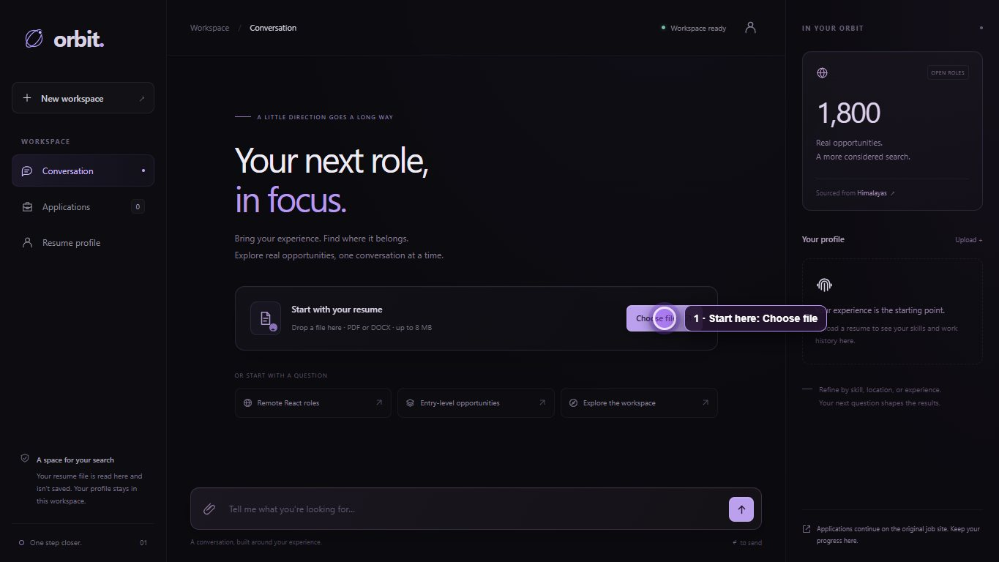

## 0:18–0:48 — Upload and profile

Click **Choose file** and select the prepared PDF. Wait until the profile and jobs appear. Point at the name and role in the right panel, then click the profile icon at the top-right of the conversation and expand work experience, education and projects.

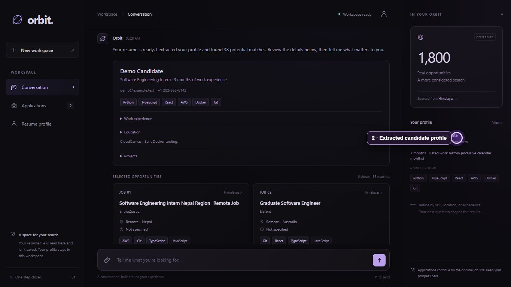

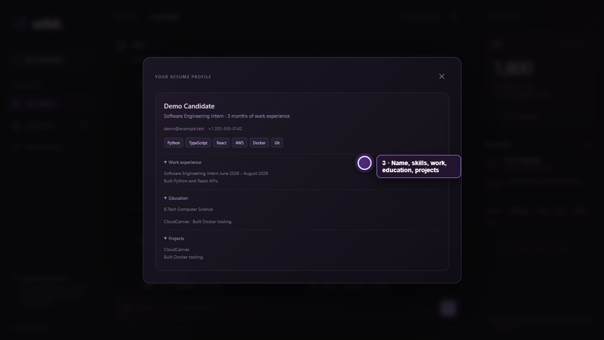

## 0:48–1:18 — Matching and chat filters

Point at a card's **THE FIT** explanation. Then click the message box and send `remote React jobs in India`. Keep the pointer on the filter chips while the new results are visible. If your resume gives zero matches, use `remote React jobs`.

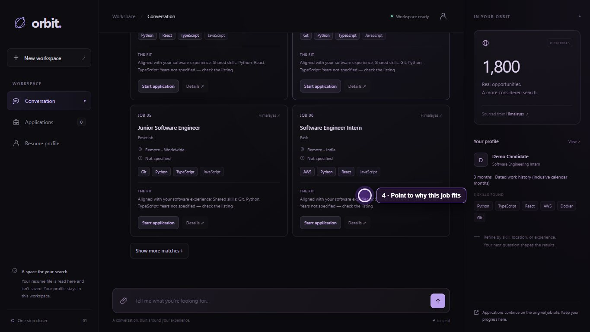

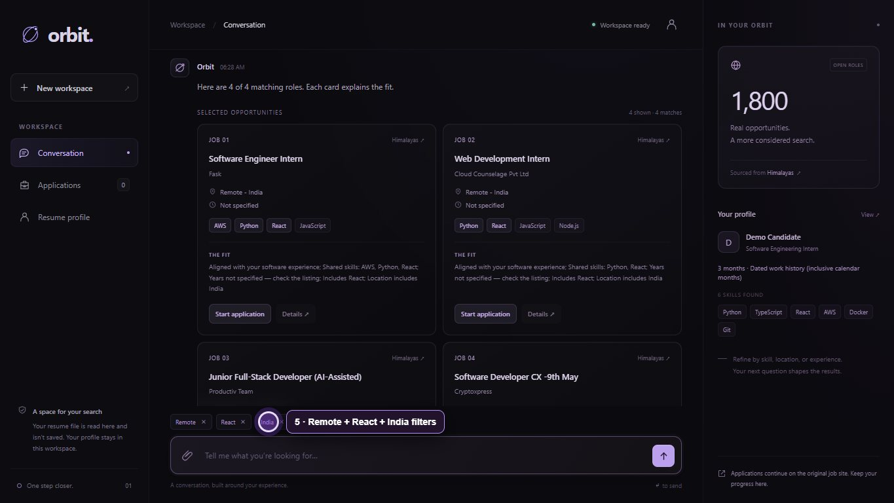

## 1:18–1:43 — Job details and assisted application

Click **Details ↗** on a visible result. Point at the role title and full description; scroll to the source button only if time allows. Close the dialog, then click **Start application** on a result. Point at **Awaiting submission** and the original application link. Do **not** click **I submitted this** without submitting the employer form yourself.

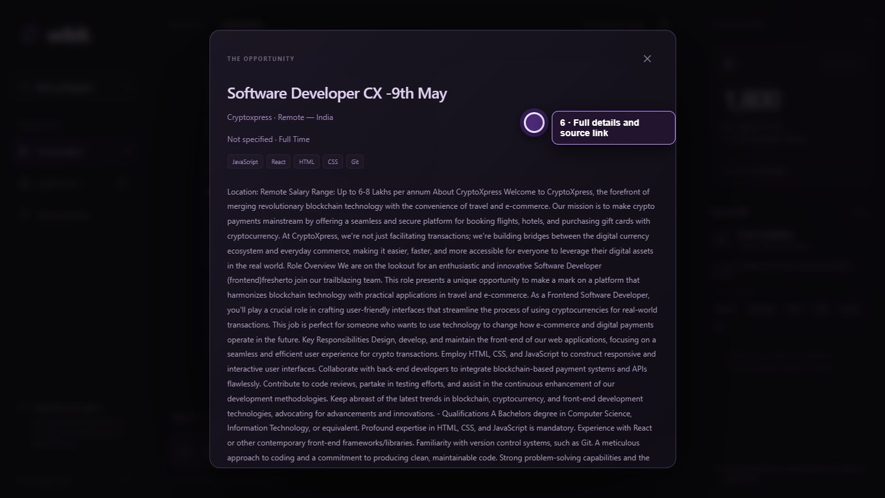

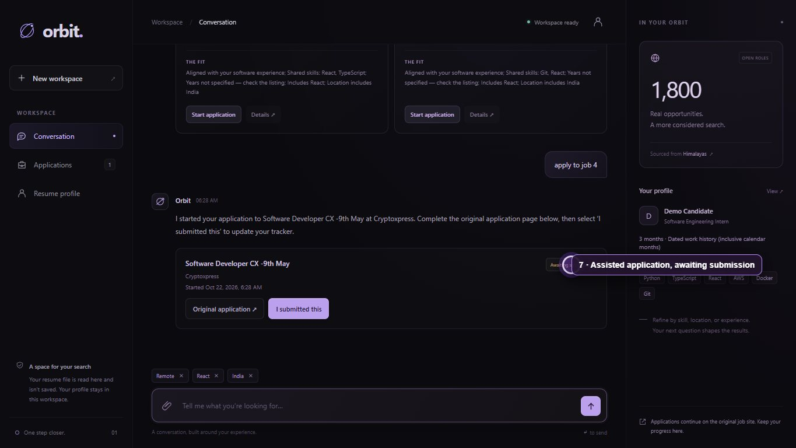

## 1:43–2:05 — Tracker and persistence

Click **Applications** in the left sidebar. Point at the job, start date and **Awaiting submission** status. Refresh the browser. Point at the restored record.

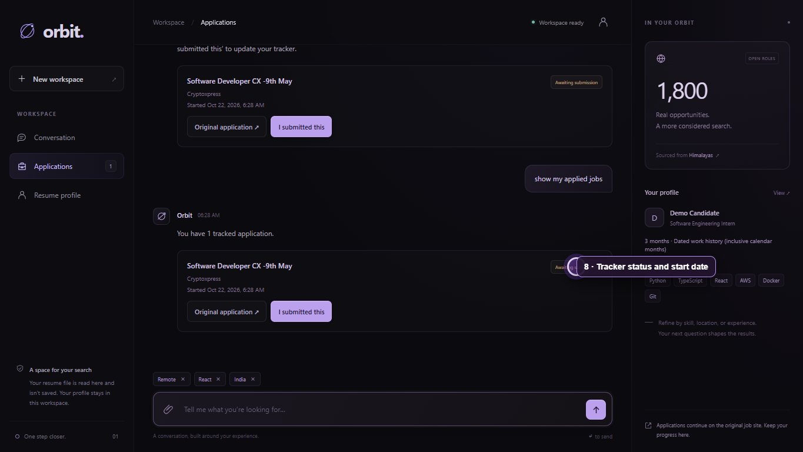

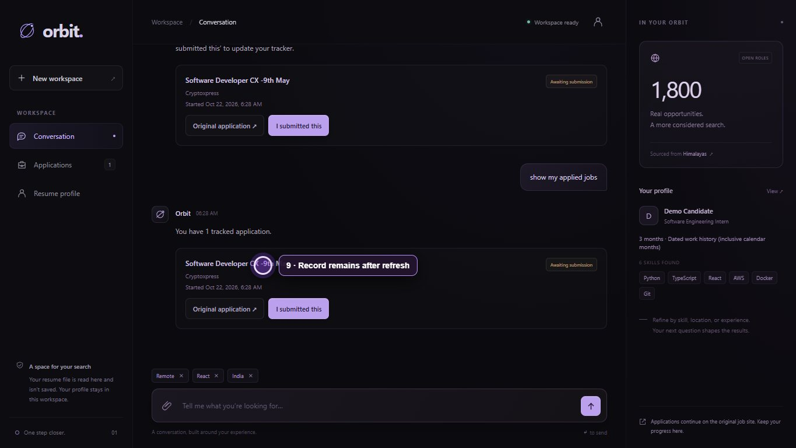

## 2:05–2:40 — Source and architecture

Switch to your pre-opened [GitHub repository](https://github.com/ABHISHEK27Y/hidani-assessment). Briefly point at the `data` and `scripts` folders, the `jobs.json` file, the top of `scrape_jobs.py`, the README architecture diagram, and `app/agent.py`. The JSON file is about 9.4 MB, so GitHub may show **View raw** instead of an inline preview; showing the tracked file is sufficient.

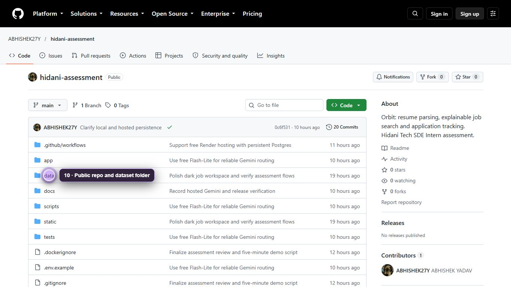

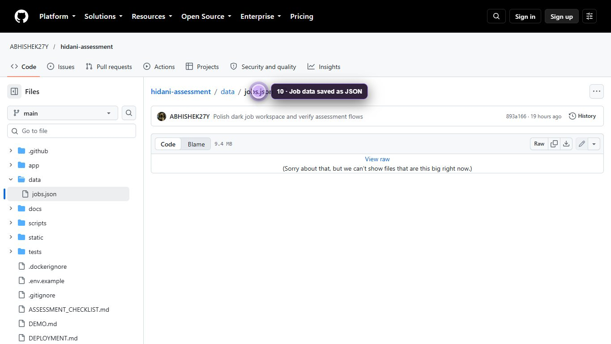

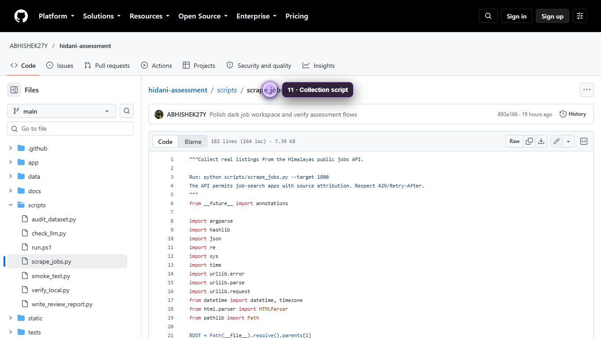

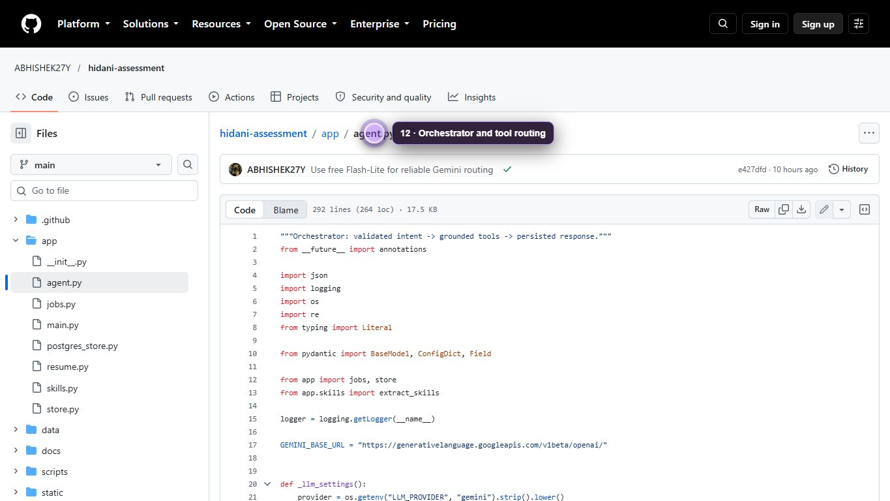

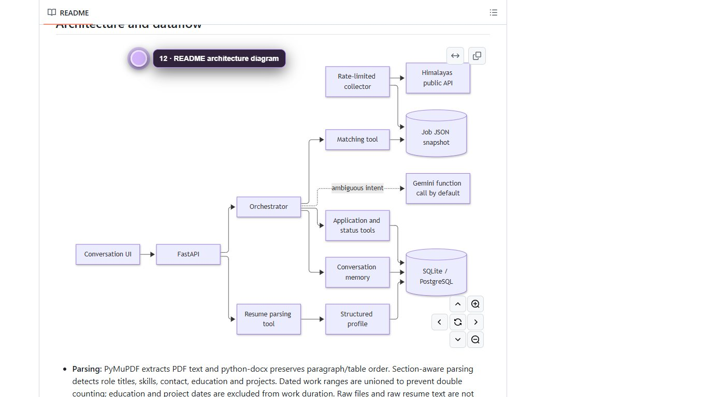

## 2:40–3:00 — Checklist and limitation

Open [`ASSESSMENT_CHECKLIST.md`](https://github.com/ABHISHEK27Y/hidani-assessment/blob/main/ASSESSMENT_CHECKLIST.md). Point at the checked requirements, then pause on **F13 — Partial** while saying the external employer form is not auto-submitted. Finish on the live app.

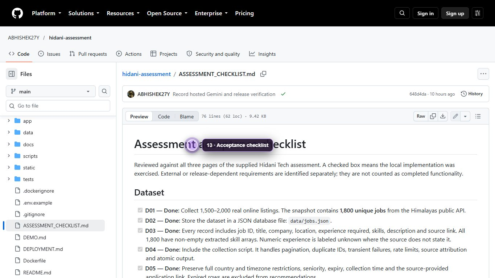

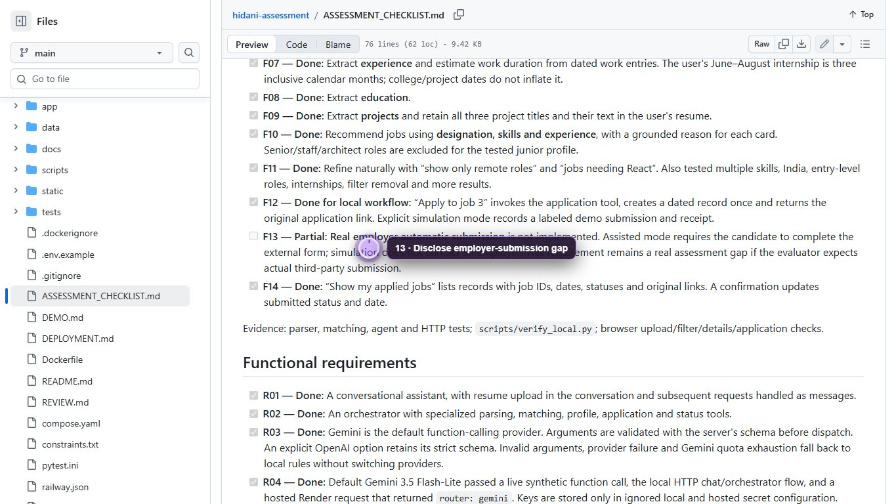

## OBS before the take

OBS Studio was confirmed installed and running on this laptop. In its first-run wizard, choose **Optimize just for recording**. Add the browser as a **Window Capture** source, and speak while watching the **Mic/Aux** meter. Record ten seconds, play it back, and check both picture and voice. Use a single browser window so switching between the app and GitHub tabs stays in the capture. If Window Capture is blank, use Display Capture. Keep notifications, credentials and private contact details out of view.
